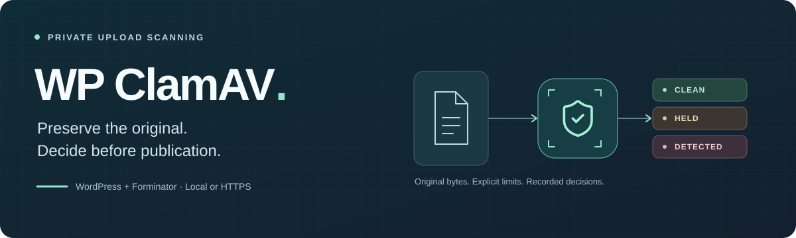
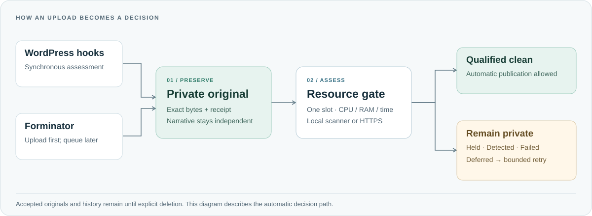

<a name="wp-clamav"></a>

<p align="center">
  <picture>
    <source media="(max-width: 640px)" srcset="docs/assets/hero-mobile.svg">
    
  </picture>
</p>

<p align="center">
  <a href="https://github.com/Barbarrosa/wp-clamav/actions/workflows/compact-plugin.yml"></a>
  <a href="docs/getting-started.md#check-compatibility"></a>
  <a href="LICENSE"></a>
  <a href="#project-status"></a>
</p>

<p align="center">
  <a href="docs/getting-started.md"><strong>Get started</strong></a> ·
  <a href="docs/README.md">Documentation</a> ·
  <a href="docs/architecture.md">Architecture</a> ·
  <a href="CONTRIBUTING.md">Contribute</a>
</p>

**WP ClamAV** preserves upload originals in private storage, scans their exact
bytes, and records a decision before WordPress may publish a copy. It supports
WordPress upload and sideload APIs, plus Forminator's normal and AJAX uploads.

| <br>Private by default | <br>Bounded scanner work | <br>Choose your coverage |
| :--- | :--- | :--- |
| Originals and history stay until explicit deletion. | One shared slot. CPU pacing. Explicit work limits. | Full database or guarded PDF/JPEG/PNG profile. |

## Project status

> **Experimental · staging first.** Actual SiteGround GrowBig deployment is not
> qualified. The plugin starts disabled and needs confirmed storage, CPU, memory
> and mail allocations. Unknown capacity holds the affected work.

| Component | Requirement or tested target |
| --- | --- |
| PHP | **8.2+**; no Composer dependencies |
| WordPress | Declared minimum **6.4**; integration fixture **7.1.4** |
| Forminator | Adapter qualified for **1.58.4**; other versions hold attachments |
| Local native bundle | Linux **x86-64 / glibc 2.36** target; hosting capacity and permissions need separate checks |
| Releases | CI produces pending candidates; installable signed releases require protected promotion and configured keys |

The website plugin needs no resident daemon, root access, Python or on-site
compilation. Native binaries and databases are separate from the plugin ZIP.
An optional remote gateway has its own deployment requirements.

<a name="installation"></a>
<a name="resource-configuration"></a>

## Start on a staging site

1. Install a reviewed plugin ZIP and keep protection disabled during setup.
2. Configure private storage outside **every** website document root.
3. Choose a verified local native bundle or an authenticated HTTPS gateway.
4. Enter confirmed resource allocations, select a profile, and configure notifications.
5. Enable protection on staging, test all outcomes and scheduling, then apply the qualified configuration to the live site.

Follow the [installation guide](docs/getting-started.md) for exact UI locations,
backend choices and the staging checklist. The
[configuration reference](docs/configuration.md) explains every allocation group.

<a name="scan-and-retention-behavior"></a>

## How it works

<picture>
  <source media="(max-width: 640px)" srcset="docs/assets/upload-flow-mobile.svg">
  
</picture>

WordPress upload hooks assess synchronously. Forminator queues scans only after
a trusted final submission; its narrative remains independent of scan completion.
One bounded dispatch path handles retries and refuses duplicate engine work.

- **Publication:** automatic release needs a completed, qualified clean result
  bound to the original hash and length. Administrators can request a full scan
  or record an explicit, audited manual decision.
- **Profiles:** `full` is the default. `pdf-jpeg-png-pe-exclusions` retains generic,
  effect, dependency, custom and uncertain rules. Reaching an excluded capability holds
  the original, including embedded executables.
- **Notifications:** multiple rules and recipients; original attachments and
  email-verified review links are separately opt-in. Failed or incomplete work
  never creates file-sharing capabilities. Completed held/detected review has
  its own eligibility rules.
- **Updates:** plugin code and native code use authenticated release channels.
  On-site FreshClam retrieves database updates directly from original ClamAV
  sources. Maintenance has priority and reserved CPU capacity.

See the [architecture](docs/architecture.md), [notification policy](docs/notifications.md)
and [scan dispatch](docs/scan-dispatch.md) references for the precise boundaries.
Plugins that write directly to arbitrary public paths need their own adapter;
existing public uploads are not retrospectively made private.

<a name="notifications-and-testing"></a>

## Find the right guide

| I want to… | Start here |
| --- | --- |
| Install and qualify a staging site | [Getting started](docs/getting-started.md) |
| Configure limits or understand a hold | [Configuration](docs/configuration.md) · [Troubleshooting](docs/troubleshooting.md) |
| Operate notifications and retained data | [Notifications](docs/notifications.md) · [Storage](docs/storage-accounting.md) |
| Change an adapter, backend or datastore boundary | [Architecture](docs/architecture.md) · [Development](docs/development.md) |
| Build, sign or promote a release | [Release guide](docs/releases.md) |

## Develop locally

With PHP 8.2+ and Python 3 available, run from the repository root:

```sh
php tests/run.php
python3 tools/lint_php.py --source .
python3 -m unittest discover -s tools -p 'test_*.py'
```

Real WordPress/Forminator, multisite and native tests use explicitly marked
disposable fixtures. See [development](docs/development.md) and
[contributing](CONTRIBUTING.md) before running them. CI builds pinned environments
and never deploys a live site.

<hr>

GPL-2.0-or-later · [License](LICENSE) · [Visual sources and licenses](docs/visual-assets.md)
· [Documentation index](docs/README.md)
