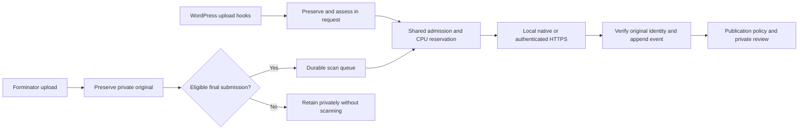

<a href="../README.md">WP ClamAV</a> / <a href="README.md">Documentation</a>

# Architecture

Follow an original from private reception to a recorded decision. The WordPress
plugin coordinates storage, policy and notifications; the native ClamAV bundle
performs scanning and official database maintenance.

## Two upload paths, one policy

Core WordPress uploads are assessed **synchronously before publication**.
Forminator preserves originals first and queues eligible work **after a validated
final submission**. Both paths use the same admission and result checks.

The paths differ deliberately:

| Entry point | Scan timing | Resulting file handling |
| --- | --- | --- |
| WordPress upload, sideload and `wp_upload_bits` | During the request | WordPress may publish a copy only when publication policy permits it. The canonical original stays private. |
| Forminator submission or separate AJAX upload | After eligible final submission | Form fields contain private receipt references; narrative submission remains independent of scan completion. |
| Administrator retry or full scan | Through explicit queued intent | Actor and requested profile are recorded. A full scan still needs sufficient resources. |

Draft, abandoned, spam, pending-payment and preview entries cannot authorize an
automatic scan. A genuine AJAX receipt alone cannot authorize one either. See
[scan dispatch](scan-dispatch.md) for lifecycle checks, replay handling and queue
bounds.

## Where to find the implementation

| Responsibility | Source | What to look for |
| --- | --- | --- |
| WordPress lifecycle | [Plugin](../src/WordPress/Plugin.php), [CoreUploads](../src/WordPress/CoreUploads.php), [Forminator](../src/WordPress/Forminator.php) | Hooks, request interception, per-blog application factory and queue wake-ups. |
| Composition | [Application](../src/Application.php) | Storage and backend selection, network coordination, queue processing and maintenance. |
| Intake and decisions | [IntakeService](../src/Scanning/IntakeService.php), [ScanResult](../src/Scanning/ScanResult.php) | Original preservation, eligibility, identity checks and publication authorization. |
| Execution | [LocalBackend](../src/Scanning/LocalBackend.php), [ProcessRunner](../src/Scanning/ProcessRunner.php), [RemoteBackend](../src/Scanning/RemoteBackend.php) | Streaming snapshots, subprocess supervision and authenticated HTTPS transport. |
| Capacity | [ResourcePolicy](../src/Resources/ResourcePolicy.php), [WorkLedger](../src/Resources/WorkLedger.php) | Confirmed allocations, deadlines, CPU reservations and pacing. |
| Canonical persistence | [FileSubmissionStore](../src/Storage/FileSubmissionStore.php), [SubmissionStore](../src/Contracts/SubmissionStore.php) | Originals, receipts, immutable events, narrative and audited deletion. |
| Notifications | [NotificationManager](../src/Notifications/NotificationManager.php), [AssetPolicy](../src/Notifications/AssetPolicy.php) | Per-recipient delivery, OTP review grants and final file-sharing checks. |
| Updates | [CodeUpdateClient](../src/Updates/CodeUpdateClient.php), [NativeUpdateManager](../src/Updates/NativeUpdateManager.php), [PluginUpdates](../src/WordPress/PluginUpdates.php) | Separate native, database and plugin update paths. |

## A scan result must identify its evidence

[`ScannerBackend::scan()`](../src/Scanning/ScannerBackend.php) receives a readable
original stream, receipt, profile and calculated limits. It returns protocol 1
data checked by [`ScanResult::validate()`](../src/Scanning/ScanResult.php).

The result binds the original SHA-256 and byte length, requested and effective
profile, engine version and database generation. Completion, applicability and
coverage qualification are separate booleans. A `clean` label alone cannot
authorize publication.

| Outcome | Meaning for the normal publication path |
| --- | --- |
| `clean` | Requires completed, qualified and applicable coverage, matching original identity and no findings. |
| `detected` | Findings exist; publication is withheld. |
| `held` | Policy, applicability or capacity needs review; publication is withheld. |
| `failed` | Execution or validation did not establish an approved result; publication is withheld. |

A new assessment revokes earlier automatic approval before fallible work starts.
An administrator can make a separate, explicit and audited manual publication
decision. That decision does not rewrite scanner evidence into a clean verdict.

File sharing has its own boundary. An explicitly enabled review rule may share a
completed held or detected original, but failed or incomplete work cannot share
one. Native limit, parser, encryption and unknown-layer warnings withhold assets
even alongside detections. See [notifications](notifications.md).

## Resources cover the whole job

Admission happens before scan hashes, snapshot copies or native startup. One
shared OS lock covers preparation, execution, reaping, final verification and
accounting. An inherited descriptor keeps the slot occupied while an admitted
native descendant still runs.

Local execution applies native address-space, cumulative CPU and wall limits.
Remote execution streams the original to the configured HTTPS service; the
website retains its canonical original. Both paths reserve CPU work, pace scans
and defer when capacity is unknown or unavailable. Maintenance has priority over
new scans and a reserved share of the confirmed CPU allocations.

These controls bound ClamAV work. They do not provide an aggregate kernel memory
quota or replace hosting protection for HTTP and PHP traffic. Read
[resource constraints](resource-constraints.md) for the precise scope.

## Canonical data and operational state

The private filesystem store is authoritative. Its `objects`, `receipts`,
`events`, `submissions` and `audit` namespaces retain original data and history.
The WordPress index is advisory; an index failure cannot remove the canonical
original from review.

Scratch copies, queue markers and rolling usage counters are operational state.
They may be retired or expire according to their own policies. Original files,
narrative and immutable scan history remain until explicit authorized deletion.
Backups must include the private store and WordPress database together. See
[storage accounting](storage-accounting.md).

Multisite gives each blog its own retained namespace. Network-managed sites share
native program/state locations and account CPU/mail coordination; the configured
retained-storage allocation is divided by site count.

## Updates and extension boundaries

Plugin updates use WordPress's updater with a separately verified signed ZIP.
Native code is staged from authenticated releases; the native updater validates
a matching database before atomically selecting the program/database tuple.
Official database updates come directly from ClamAV sources. A plugin update
does not itself activate native code or replace database state. See
[release procedures](releases.md).

Trusted server integrations can select a backend with `wp_clamav_backend` or
supply a `ResourcePolicy` with `wp_clamav_resource_policy`; both filters receive
the current object and settings. They execute trusted PHP and must preserve the
same privacy, identity and admission guarantees. They are not public upload APIs.

`SubmissionStore` separates canonical persistence from intake and notification
behavior. It is a seam for future datastore work, not an available external-store
setting: this implementation still uses private on-site files and performs no
data migration.

**Next:** [development and testing](development.md) ·
[configuration reference](configuration.md) · [documentation index](README.md)
